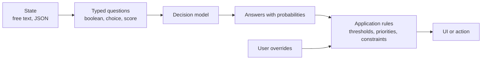
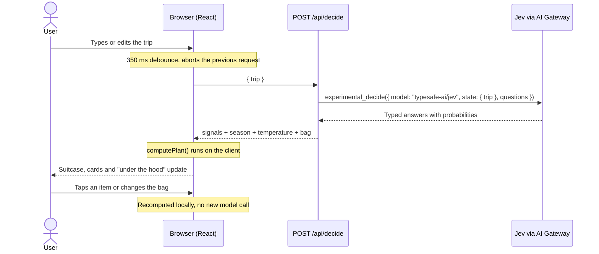
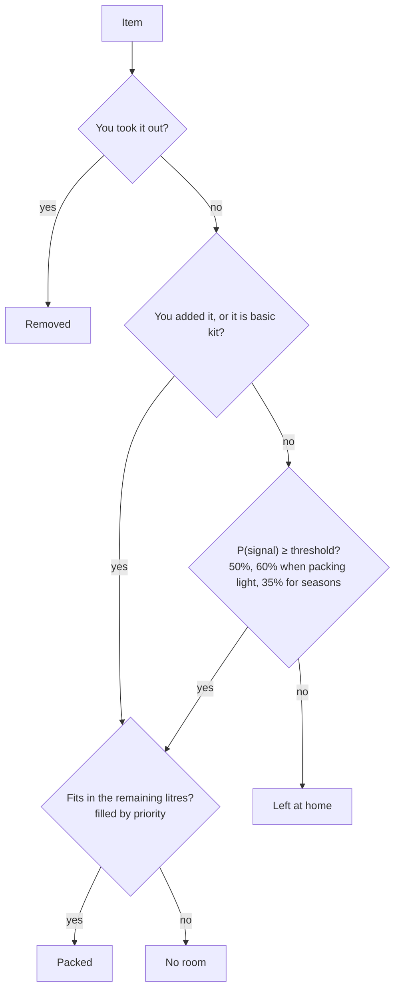

# Smart Packing Demo with Jev

This demo shows one possible use case for **decision models**: turning free-form
text into typed, probability-scored decisions that application code can act on.

Here the text is a trip description and the decisions are what to pack. Whenever the
text settles (350 ms), the app asks [Jev](https://vercel.com/ai-gateway/models/jev)
(`typesafe-ai/jev`, through Vercel AI Gateway) every packing question in **a single
call** (~300 ms). The suitcase reacts as you type: items go in and out, the bag size
changes and anything that doesn't fit is flagged.

**Stack:** Next.js 16 (App Router, Cache Components) · AI SDK 7 (`experimental_decide`)
· Vercel AI Gateway · Tailwind CSS 4.

## Why decision models

A decision model doesn't generate text. You give it a **state** (here, the trip) and
a set of **typed questions** (yes/no, multiple choice or a score on a scale), and it
returns an answer with probabilities for each one. That shapes how the app is built:

- **The model judges, the code decides.** Thresholds, priorities and the bag's
  capacity are plain TypeScript, so behaviour is predictable, testable and easy to
  explain: every card says why it is there ("92% sun").
- **Many questions, one call.** All 17 questions go in one request of about 300 ms
  and cost a fraction of a cent, cheap enough to run every time you pause typing.
- **Probabilities, not prose.** There is no output to parse and no format to break.
  Uncertainty stays visible: at 44% rain, the umbrella stays home.
- **People stay in control.** The model proposes and the user overrides; their
  choices sit on top of the model's answers instead of being lost on the next call.

## The pattern

Packing is just one instance of a pattern that carries over to other domains:



| Use case                 | State                   | Example questions                                    | Application rule                       |
| ------------------------ | ----------------------- | ---------------------------------------------------- | -------------------------------------- |
| **Packing (this demo)**  | Trip description        | Will it rain? Which season? Which bag?               | Pack an item above its threshold, within the litres |
| Support ticket triage    | Customer message        | Which team? How severe? Is it a refund request?      | Route automatically above 90%, otherwise to a person |
| Content moderation       | Post or comment         | Is it spam? How toxic is it?                         | Hide, flag for review or publish       |
| Lead qualification       | Contact form submission | Company size? Buying intent? Budget mentioned?       | Send to sales or to a nurture sequence |
| Email filtering          | Incoming email          | Is it urgent? Does it need a reply? Which project?   | Label, prioritise or archive           |

## Inspiration

This demo is inspired by the real-time packing demo powered by a local
[Laya](https://unsloth.ai/docs/models/decision-laya) model through Unsloth's Decision
API, where suitcase items update as you type and change your travel plans. This
version recreates the idea as a Vercel web app, calling Jev through AI Gateway
instead of a locally served model.

## How it works



Jev is a **decision** model: it doesn't generate text, it answers typed questions
with probabilities. The app asks it 17 things at once:

| Type      | Question                                                                                   | Used in the UI                         |
| --------- | ------------------------------------------------------------------------------------------ | -------------------------------------- |
| `boolean` | 14 signals: sun, cold, snow, rain, swimming, hiking, sightseeing, abroad, flying, reading, work, dress code, workouts, pack light | Probability that unlocks each item |
| `choice`  | Season at the destination (winter / spring / summer / autumn), minding the hemisphere     | Unlocks the seasonal wardrobe          |
| `score`   | Temperature (5 levels, from "Freezing" to "Hot")                                           | Subtitle "≈ winter · freezing…"        |
| `choice`  | Bag: 18 L / 24 L / 40 L / 65 L                                                             | Default size ("Jev picks")             |

The call, simplified (see [`decision.ts`](src/lib/packing/decision.ts)):

```ts
import { experimental_decide as decide } from "ai";

const result = await decide({
  model: "typesafe-ai/jev",
  state: { trip },
  questions: {
    snow: { type: "boolean", instructions: "Will there be snow, ice or freezing temperatures?" },
    season: {
      type: "choice",
      instructions: "Which season will it be at the destination? Mind the hemisphere…",
      criteria: { winter: "…", spring: "…", summer: "…", autumn: "…" },
    },
    temperature: { type: "score", criteria: ["Freezing…", "Cold…", "Mild…", "Warm…", "Hot…"] },
    // …
  },
});

result.answers.snow.probability;      // 0.93
result.answers.season.probabilities;  // { winter: 1, spring: 0, summer: 0, autumn: 0 }
```

### Packing rules

The logic lives in [`plan.ts`](src/lib/packing/plan.ts). It is pure and recomputed on
the client, so changing the bag or tapping an item never triggers another model call.

1. **Basic kit** items always go in.
2. Each item depends on one signal and goes in when `P(signal) ≥ 50%` (60% if Jev
   detects that you want to pack light). Seasonal clothing goes in from 35%,
   because the four seasons compete in a single distribution.
3. The bag fills up by priority (your picks → basics → strongest signal) until it
   runs out of litres. Anything that doesn't fit is marked "no room".
4. Tapping an item takes it out or puts it in: you have the final say. "Reset to Jev"
   undoes your changes.



"Under the hood" (in the footer) shows the raw probabilities with the threshold
marker, the season distribution, the temperature and the chosen bag.

### Why Jev and not Laya

The first version used Laya (`convaiinnovations/laya`), which has an 8k-token context
window. Jev offers 32k, native probability distributions for `choice` and `score`
questions, and costs $0.042 per million input tokens. You can switch models with
`DECISION_MODEL` without touching the code.

## Measured results

Real calls to `typesafe-ai/jev` with the app's presets:

| Preset              | Season       | Temperature | Bag  | Latency | Strong signals (≥ 50%)                        |
| ------------------- | ------------ | ----------- | ---- | ------- | --------------------------------------------- |
| Summer escape       | summer 97%   | hot         | 24 L | 425 ms  | sun, swimming, reading, abroad, pack light    |
| Autumn mountains    | autumn 100%  | cold        | 24 L | 371 ms  | cold, rain, hiking, snow 77%                  |
| Winter markets      | winter 100%  | freezing    | 65 L | 314 ms  | cold, snow, sightseeing, dress code 64%       |
| Spring blossoms     | spring 100%  | mild        | 24 L | 267 ms  | sightseeing, abroad, rain 56%                 |
| July in Patagonia   | winter 100%  | freezing    | 65 L | 385 ms  | cold, snow, hiking, flying                    |

"July in Patagonia" checks that Jev understands July is winter in the southern
hemisphere. In practice seasons almost always come out close to 100%, so the 35%
threshold rarely matters.

## Run locally

```bash
git clone https://github.com/poacosta/smart-packing-with-jev.git
cd smart-packing-with-jev
npm install
cp .env.example .env.local   # add your AI_GATEWAY_API_KEY
npm run dev
```

| Variable             | Purpose                                                                 |
| -------------------- | ----------------------------------------------------------------------- |
| `AI_GATEWAY_API_KEY` | AI Gateway key (Vercel dashboard → AI Gateway → API Keys)               |
| `DECISION_MODEL`     | Optional. Decision model, defaults to `typesafe-ai/jev`                 |

`.env.local` is git-ignored: never commit your key. The key is only read on the
server and never reaches the browser.

Without credentials, `/api/decide` uses an **offline keyword fallback**. The UI shows
a banner when that happens. It is handy for working on the interface without
spending calls, but it is not what the demo is about.

Scripts: `npm run dev`, `npm run build`, `npm run start`, `npm run lint`.

## Deploy to Vercel

```bash
npm i -g vercel
vercel link
vercel env pull      # fetches VERCEL_OIDC_TOKEN for local development
vercel deploy
```

On Vercel the Gateway authenticates with OIDC automatically, so there is no need to
upload the key.

## API

`POST /api/decide` with `{ "trip": "…" }` (2000 characters max):

```json
{
  "signals": { "sun": 0.43, "cold": 0.94, "snow": 0.87, "…": 0, "winter": 1, "spring": 0, "summer": 0, "autumn": 0 },
  "season": "winter",
  "temperature": 0.93,
  "bag": "checked",
  "bagProbabilities": { "underseat": 0, "cabin": 0, "carryon": 0.18, "checked": 0.82 },
  "source": "model",
  "model": "typesafe-ai/jev",
  "latencyMs": 385
}
```

`source` is `"offline"` when the fallback answered. Errors return `{ "error": "…" }`
with status 400 (empty trip) or 502 (the model call failed; details are only logged
on the server).

## Project structure

```
src/lib/packing/catalog.ts   signals, seasons, items (litres + signal), bags, presets
src/lib/packing/decision.ts  experimental_decide against Jev + offline fallback
src/lib/packing/plan.ts      thresholds, capacity and overrides → packing plan (pure)
src/lib/packing/art.ts       detects the illustrations in public/items/
src/app/api/decide/route.ts  POST { trip } endpoint → signals
src/components/              UI (suitcase, cards, "under the hood", debounced hook)
```

## Customizing

Everything comes from [`catalog.ts`](src/lib/packing/catalog.ts); the questions sent
to the model are generated from it.

- **New item:** add `{ id, name, emoji, liters, signal }` to `ITEMS`. `signal` is a
  signal, a season or `"basic"`.
- **New signal:** add an entry to `SIGNALS` with a `label` and a `question`, plus its
  regex in `KEYWORDS` in `decision.ts` for the fallback.
- **Thresholds:** `BASE_THRESHOLD`, `PACK_LIGHT_THRESHOLD` and `SEASON_THRESHOLD` in `plan.ts`.
- **Presets:** `PRESETS` in `catalog.ts`.

## Illustrations

Until there are images, items show an emoji. Save each illustration as
`public/items/<id>.png` (`.webp`, `.svg` and `.jpg` also work) and it replaces the
emoji automatically. Recommended format: square PNG with a transparent background,
about 256×256.

Suggested base prompt:

> Flat vintage travel illustration of a {item}, soft muted palette (sage green,
> terracotta, cream, mustard), subtle paper grain, gentle shading, centered,
> isolated on a transparent background, no text.

| Group    | ids                                                                                   |
| -------- | ------------------------------------------------------------------------------------- |
| Basics   | `cotton-tees`, `walking-shoes`, `phone-charger`, `water-bottle`, `wash-bag`           |
| Summer   | `linen-shirt`, `summer-dress`, `tank-tops`, `linen-trousers`                          |
| Spring   | `trench-coat`, `cardigan`, `light-chinos`, `white-sneakers`                           |
| Autumn   | `denim-jacket`, `flannel-shirt`, `dark-jeans`, `ankle-boots`                          |
| Winter   | `wool-coat`, `wool-scarf`, `fleece-pullover`, `winter-boots`                          |
| Weather  | `easy-shorts`, `sandals`, `sunglasses`, `sunscreen`, `sun-hat`, `cozy-knit`, `thermal-layers`, `puffer-jacket`, `beanie-gloves`, `rain-jacket`, `tiny-umbrella` |
| Activity | `swimwear`, `hiking-boots`, `daypack`, `little-camera`, `passport`, `travel-adapter`, `headphones`, `good-book`, `laptop`, `smart-outfit`, `dress-shoes`, `running-kit` |

## Troubleshooting

- **The "Offline keyword fallback" banner shows up:** `AI_GATEWAY_API_KEY` is missing
  from `.env.local`, or the server started before you added it. Restart `npm run dev`.
- **I added an illustration and it doesn't show:** the image list is cached; restart
  the dev server (in production it is read at build time).
- **502 error in the status line:** the model call failed. The details are in the
  server logs (`Decision failed`).
- **"Autumn mountains" packs the puffer jacket and the beanie:** Jev puts snow at 77%
  for 3°C in the Highlands. You can refine the `snow` question or raise its threshold.
