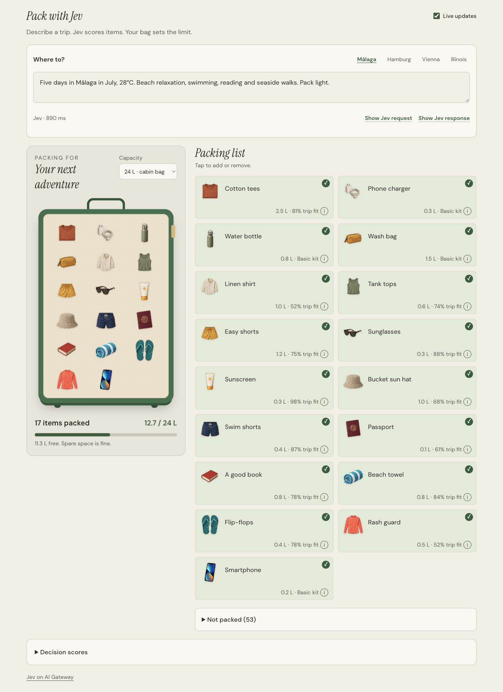
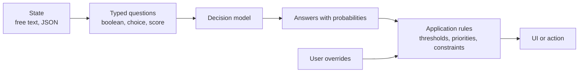
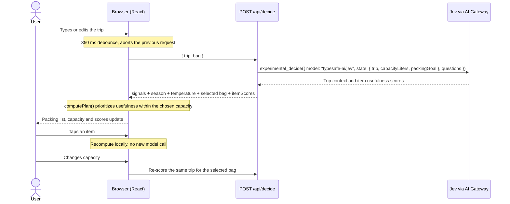
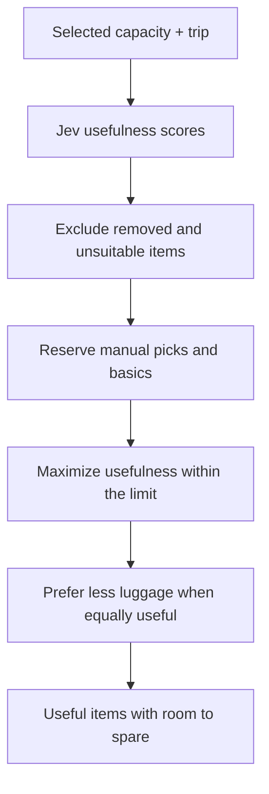

# Smart Packing Demo with Jev



This demo shows one possible use case for **decision models**: turning free-form
text into typed, probability-scored decisions that application code can act on.

Here the text is a trip description and the decisions are what to pack. Choose
an 18, 24, 40 or 65 L bag and describe the trip. All 70 items belong to one wardrobe
of neutral-cut garments and shared accessories. Whenever the text or capacity settles
(350 ms), the app asks [Jev](https://vercel.com/ai-gateway/models/jev)
(`typesafe-ai/jev`, through Vercel AI Gateway) every packing question in **a single
call**. Jev scores which items suit the trip and chosen capacity; the app packs
useful items within that limit. Spare space is fine: it does not add clothing copies
or optional items just to fill the bag.

**Stack:** Next.js 16 (App Router, Cache Components) · AI SDK 7 (`experimental_decide`)
· Vercel AI Gateway · Tailwind CSS 4.

## Why decision models

A decision model doesn't generate text. You give it a **state** (here, the trip) and
a set of **typed questions** (yes/no, multiple choice or a score on a scale), and it
returns an answer with probabilities for each one. That shapes how the app is built:

- **The model judges, the code decides.** Thresholds, priorities and the bag's
  capacity are plain TypeScript, so behaviour is predictable, testable and easy to
  explain: every card shows usefulness, packed quantity and occupied litres.
- **Many questions, one call.** Each request asks 18 context questions plus a
  usefulness score for each of the 70 items in the shared wardrobe (88 questions
  in total), including clothing and accessories.
- **Probabilities, not prose.** There is no output to parse and no format to break.
  Uncertainty stays visible: at 44% item suitability, the umbrella stays home.
- **People stay in control.** The model proposes and the user overrides; their
  choices sit on top of the model's answers instead of being lost on the next call.
  Choosing another city preset clears those overrides.

## Try the demo

Choose a city, edit its short prompt and watch the suitcase update:

| Preset | Trip purpose | Scenario |
| --- | --- | --- |
| Málaga | Relaxation and beach | July, 28°C; swimming, reading and seaside walks |
| Hamburg | Business and work | October, 12°C and rain; meetings, conference and presentations |
| Vienna | Culture | December, -2°C and snow; museums, palaces and opera |
| Illinois (Chicago) | Leisure | April, 12°C and rain; friends, parks, baseball and live music |

The temperatures are example inputs, not live forecasts. City presets populate the
editable trip text; they do not select a separate season or clothing category.
For a controlled seasonal comparison, use the prompts in
[demo scenarios](docs/demo-scenarios.md) and change only the season word.

## The pattern

Packing is just one instance of a pattern that carries over to other domains:



| Use case                 | State                   | Example questions                                    | Application rule                       |
| ------------------------ | ----------------------- | ---------------------------------------------------- | -------------------------------------- |
| **Packing (this demo)**  | Trip description and capacity | Will it rain? Which season? How useful is each item? | Pack useful items within the selected capacity |
| Support ticket triage    | Customer message        | Which team? How severe? Is it a refund request?      | Route automatically above 90%, otherwise to a person |
| Content moderation       | Post or comment         | Is it spam? How toxic is it?                         | Hide, flag for review or publish       |
| Lead qualification       | Contact form submission | Company size? Buying intent? Budget mentioned?       | Send to sales or to a nurture sequence |
| Email filtering          | Incoming email          | Is it urgent? Does it need a reply? Which project?   | Label, prioritise or archive           |

## Inspiration

This demo is inspired by the real-time packing demo powered by a local
[Laya](https://unsloth.ai/docs/models/decision-laya) model through Unsloth's Decision
API, where suitcase items update as you type and change your travel plans. This
version recreates the idea as a Vercel web app, calling Jev through AI Gateway
instead of a locally served model.

## How it works



Jev is a **decision** model: it doesn't generate text, it answers typed questions
with probabilities. The app asks it 88 things at once for the shared wardrobe:

| Type      | Question                                                                                   | Used in the UI                         |
| --------- | ------------------------------------------------------------------------------------------ | -------------------------------------- |
| `boolean` | 16 signals: sun, cold, snow, rain, swimming, hiking, sightseeing, abroad, flying, reading, work, conferences, parties, dress code, workouts, pack light | Trip context shown under the hood |
| `choice`  | Season at the destination (winter / spring / summer / autumn), minding the hemisphere     | Seasonal context          |
| `score`   | Temperature (5 levels, from "Freezing" to "Hot")                                           | Decision scores        |
| `score`   | Usefulness of each available wardrobe item, given the trip and selected capacity (5 levels) | Useful items within the capacity limit |

The call, simplified (see [`decision.ts`](src/lib/packing/decision.ts)):

```ts
import { experimental_decide as decide } from "ai";

const result = await decide({
  model: "typesafe-ai/jev",
  state: { trip, capacityLiters: 24, packingGoal: "Pack useful items within the selected capacity; spare space is fine." },
  questions: {
    snow: { type: "boolean", instructions: "Will there be snow, ice or freezing temperatures?" },
    season: {
      type: "choice",
      instructions: "Which season will it be at the destination? Mind the hemisphere…",
      criteria: { winter: "…", spring: "…", summer: "…", autumn: "…" },
    },
    temperature: { type: "score", criteria: ["Freezing…", "Cold…", "Mild…", "Warm…", "Hot…"] },
    // …
  },
});

result.answers.snow.probability;      // 0.93
result.answers.season.probabilities;  // { winter: 1, spring: 0, summer: 0, autumn: 0 }
```

### Packing rules

The logic lives in [`plan.ts`](src/lib/packing/plan.ts). It is pure and recomputed
on the client. Changing capacity asks Jev to re-score the trip; manual item edits
recompute the plan locally.

1. The traveller selects the capacity. All clothing and accessories are sent to
   the model and available in the packing lists, with neutral cuts and styling. The model
   scores their usefulness from 0 to 4, normalized to 0–1 in the response.
2. Reserve one unit of each manual pick, then each basic item, while space allows.
3. Consider other items with a usefulness score of at least 50% (useful or better).
   Optional items stay at home unless the traveller adds them manually.
4. Use a capacity search in integer decilitres to maximize total usefulness without
   exceeding the limit. Among equally useful plans, prefer the one using less space.
5. Pack each catalog item at most once. Clothing copies are never added just to
   fill space. A larger bag can therefore keep the same contents and more free space.
6. Tapping an item removes it and recomputes the remaining useful picks within the
   limit. "Reset to Jev" clears manual overrides.

Each item includes specific climate and activity guidance in its question. For
example, a winter coat, spring trench, party shirt and business shirt are judged
for their intended uses rather than treated as interchangeable clothes. An explicit
season in the input sets the scenario; dates are used to infer it only when no
season is named. Explicit temperatures take precedence for warmth requirements.
Phone, charger, water bottle and toiletries are the basic kit. Clothing and shoes
are scored for the trip. Visible cards follow item suitability; rejected items
remain available under "Not packed". The catalog uses neutral-cut clothing and
plain accessories, with distinct materials and functions for each occasion.
Clothing preferences can be described in the trip text.

See [demo scenarios](docs/demo-scenarios.md) for controlled seasonal and activity
comparisons, including prompts that change only one word.



"Show Jev request" reveals the last SDK input: model, trip state, questions and
retry setting. "Show Jev response" reveals the original SDK answers and token
usage, before packing scores are normalized. Both start collapsed and show the
last successful model call. Offline mode clearly states that no Jev call was made.
"Decision scores" contains the trip probabilities and temperature.
Cards show item suitability; the capacity bar shows the limit and remaining space.

### Why Jev and not Laya

The first version used Laya (`convaiinnovations/laya`). The current implementation
uses Jev for typed answers, probability distributions and per-item scores through
the decision SDK. You can switch models with `DECISION_MODEL` without touching
the code; the replacement must support the same decision question types.

## Historical measurements

These measurements belong to the previous 17-question version, which asked the
model to choose a bag. They do not measure the current capacity-aware
requests. The UI reports each current call's latency; the figures below are not
a benchmark of the current 88-question catalog.

| Preset              | Season       | Temperature | Bag  | Latency | Strong signals (≥ 50%)                        |
| ------------------- | ------------ | ----------- | ---- | ------- | --------------------------------------------- |
| Summer escape       | summer 97%   | hot         | 24 L | 425 ms  | sun, swimming, reading, abroad, pack light    |
| Autumn mountains    | autumn 100%  | cold        | 24 L | 371 ms  | cold, rain, hiking, snow 77%                  |
| Winter markets      | winter 100%  | freezing    | 65 L | 314 ms  | cold, snow, sightseeing, dress code 64%       |
| Spring blossoms     | spring 100%  | mild        | 24 L | 267 ms  | sightseeing, abroad, rain 56%                 |
| July in Patagonia   | winter 100%  | freezing    | 65 L | 385 ms  | cold, snow, hiking, flying                    |

The retired "July in Patagonia" example checked that Jev understands July is
winter in the southern hemisphere. Current packing uses per-item usefulness
scores; season probabilities provide context rather than selecting a wardrobe.

## Run locally

```bash
git clone https://github.com/poacosta/smart-packing-demo-with-jev.git
cd smart-packing-demo-with-jev
npm install
cp .env.example .env.local   # add your AI_GATEWAY_API_KEY
npm run dev
```

| Variable             | Purpose                                                                 |
| -------------------- | ----------------------------------------------------------------------- |
| `AI_GATEWAY_API_KEY` | AI Gateway key (Vercel dashboard → AI Gateway → API Keys)               |
| `DECISION_MODEL`     | Optional. Decision model, defaults to `typesafe-ai/jev`                 |

`.env.local` is git-ignored: never commit your key. The key is only read on the
server and never reaches the browser.

Without credentials, `/api/decide` uses an **offline keyword fallback**. The status
reads "Offline demo · keyword matching". It is useful for checking the interface
without model calls, but does not provide Jev's contextual understanding.

Scripts: `npm run dev`, `npm run build`, `npm run start`, `npm run lint`.

### Verify capacity-aware packing

Run `npm run lint` and `npx tsc --noEmit`. The packing and decision tests use
Node's test runner, the existing TypeScript compiler and the SDK's mock decision
model; no additional test dependencies are required:

```bash
npx tsc src/lib/packing/plan.test.ts src/lib/packing/decision.test.ts --module commonjs --moduleResolution node --target es2021 --outDir /tmp/packing-tests --esModuleInterop --skipLibCheck
NODE_PATH="$PWD/node_modules" node --conditions=react-server --test /tmp/packing-tests/plan.test.js /tmp/packing-tests/decision.test.js
```

These tests cover the shared wardrobe and all four capacities, useful selection with spare
space, manual overrides, no duplicated items, capacity limits, and the request passed through the real
decision SDK with a mock provider. They do not measure the live Jev service.

## Deploy to Vercel

```bash
npm i -g vercel
vercel link
vercel env pull      # fetches VERCEL_OIDC_TOKEN for local development
vercel deploy
```

On Vercel the Gateway authenticates with OIDC automatically, so there is no need to
upload the key.

## API

`POST /api/decide` with `{ "trip": "…", "bag": "cabin" }`
(2000 trip characters max).
Valid bag ids are `underseat`, `cabin`, `carryon` and `checked`; omitting `bag`
defaults to `cabin`. Invalid capacities return status 400.
All 70 catalog items are considered for every request. Each response reports
the actual SDK question count, or zero for the offline fallback.
Model responses also include `request`, the serializable input used for that call.
It contains no credentials or abort signal. The `response` field contains the
original SDK `answers` and `usage`. Offline responses set both fields to `null`.

Example response excerpt (the request and raw response objects are omitted):

```json
{
  "signals": { "sun": 0.43, "cold": 0.94, "snow": 0.87, "…": 0, "winter": 1, "spring": 0, "summer": 0, "autumn": 0 },
  "season": "winter",
  "temperature": 0.93,
  "bag": "cabin",
  "questionCount": 88,
  "itemScores": { "cotton-tees": 0.35, "linen-shirt": 0.05, "wool-coat": 0.96, "…": 0 },
  "source": "model",
  "model": "typesafe-ai/jev",
  "latencyMs": 385
}
```

`source` is `"offline"` when the fallback answered. Errors return `{ "error": "…" }`
with status 400 (empty trip or invalid capacity) or 502 (the model call failed; details are only logged
on the server).

## Project structure

```
src/lib/packing/catalog.ts   signals, seasons, items (litres + signal), bags, presets
src/lib/packing/decision.ts  experimental_decide against Jev + offline fallback
src/lib/packing/plan.ts      thresholds, capacity and overrides → packing plan (pure)
src/lib/packing/art.ts       detects the illustrations in public/items/
src/app/api/decide/route.ts  POST { trip, bag } → trip signals + item scores
src/components/              UI (suitcase, capacity summary, cards, request/response viewers, scores, debounced hook)
```

## Customizing

Everything comes from [`catalog.ts`](src/lib/packing/catalog.ts); the questions sent
to the model are generated from it.

- **New item:** add `{ id, name, use, emoji, liters, signal }` to `ITEMS`.
  Every item is part of the shared wardrobe. Use `image` for an explicit
  individual illustration URL.
  `signal` is a signal, a season or `"basic"`; volumes use at most one decimal place.
  `use` describes the item's climate, activity and exclusions for Jev. Optional
  `alsoFor` signals support multiple uses in the offline keyword fallback.
- **New signal:** add an entry to `SIGNALS` with a `label` and a `question`, plus its
  regex in `KEYWORDS` in `decision.ts` for the fallback.
- **Suitability threshold:** `ITEM_SCORE_THRESHOLD` in `plan.ts`. The other signal
  thresholds support planning without per-item scores.
- **Presets:** `PRESETS` in `catalog.ts`: Málaga for beach relaxation, Hamburg
  for business and work, Vienna for culture, and Illinois (Chicago) for leisure.
  Jev infers the season from the dates, destination and weather in the trip text;
  the preset does not select a season.

## Illustrations

The catalog uses three transparent illustration sheets:
`public/illustrations/packing-atlas.png` for the original shared items,
`public/illustrations/wardrobe-atlas.png` for additional climate and activity gear,
and `public/illustrations/unisex-atlas.png` for neutral occasion clothing and
accessories. Swim shorts use `public/items/swim-shorts.png`. Unused illustrations
from earlier catalog versions are not offered as items.
The original atlas has six columns and eight rows;
`src/lib/packing/illustrations.ts` maps each item id to its pixel bounds so each
illustration stays centered without showing neighboring items. The same
illustration appears in the suitcase, cards and unpacked list.

To override an illustration, save `public/items/<id>.png` (`.webp`, `.svg` and `.jpg`
also work). Individual files take priority over the atlas. Recommended format:
square PNG with a transparent background, about 256×256. New items without an
illustration still use their configured emoji as a placeholder.

Suggested base prompt:

> Flat vintage travel illustration of a {item}, soft muted palette (sage green,
> terracotta, cream, mustard), subtle paper grain, gentle shading, centered,
> isolated on a transparent background, no text.

The following are examples; `ITEMS` in `catalog.ts` is the complete 70-item list.

| Group    | ids                                                                                   |
| -------- | ------------------------------------------------------------------------------------- |
| Basics   | `phone-charger`, `water-bottle`, `wash-bag`, `smartphone` |
| Summer   | `cotton-tees`, `linen-shirt`, `lightweight-overshirt`, `tank-tops`, `linen-trousers` |
| Spring   | `trench-coat`, `cardigan`, `light-chinos`, `white-sneakers`                           |
| Autumn   | `denim-jacket`, `flannel-shirt`, `dark-jeans`, `ankle-boots`                          |
| Winter   | `wool-coat`, `wool-scarf`, `fleece-pullover`, `winter-boots`                          |
| Weather  | `easy-shorts`, `sandals`, `sunglasses`, `sunscreen`, `sun-hat`, `cozy-knit`, `thermal-layers`, `puffer-jacket`, `beanie-gloves`, `rain-jacket`, `tiny-umbrella` |
| Activity | `swim-cap`, `swim-shorts`, `hiking-boots`, `daypack`, `little-camera`, `passport`, `travel-adapter`, `headphones`, `good-book`, `laptop`, `formal-jacket`, `formal-trousers`, `dress-shoes`, `running-kit` |

## Troubleshooting

- **The status reads "Offline demo · keyword matching":** neither an
  `AI_GATEWAY_API_KEY` nor a `VERCEL_OIDC_TOKEN` is available to the server.
  Configure credentials and restart `npm run dev`.
- **I added an illustration and it doesn't show:** the image list is cached; restart
  the dev server (in production it is read at build time).
- **502 error in the status line:** the model call failed. The details are in the
  server logs (`Decision failed`).
- **A capacity change is waiting:** enable Live so the selection is
  sent to the model. Paused mode does not issue requests.
- **Space remains:** capacity is an upper limit. The app packs useful items and
  leaves optional items out rather than adding duplicates to fill the bag.
